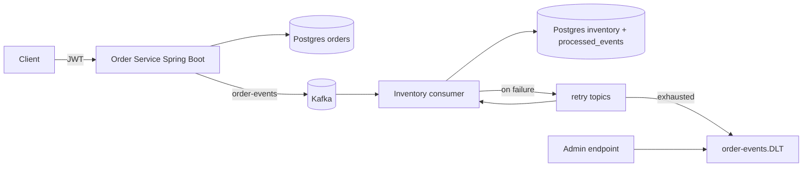

# Plan 3: Order Events Service (build third)

## Goal
A Spring Boot REST service for orders that publishes order lifecycle events to Kafka, with idempotent consumers (inventory and notification), retries, and a dead-letter topic. Integration tests run against real Kafka and Postgres with Testcontainers.

Why third: P10 Engineer II (stated $130,000-$149,000) and P11 match this stack, but they want 5+ years of production Java. This makes him interview-ready on Spring and Kafka and targets the Ford Java/Spring screen and the Kafka gap.

Job keywords it proves: Java 17/21, Spring Boot, Spring Security, Spring Data JPA, Kafka, event-driven, dead-letter queue, idempotency, Testcontainers, JUnit 5, Gradle, REST API contracts (OpenAPI), Docker.

## Scope
MVP:
- Spring Security with JWT (resource server), roles USER and ADMIN.
- Orders CRUD with state machine: CREATED, PAID, SHIPPED, CANCELLED.
- Producer publishes OrderCreated, OrderPaid, OrderCancelled events (JSON) keyed by order id.
- Consumer (inventory reservation) with idempotency via processed_events table, retry topics with backoff, dead-letter topic, admin endpoint to inspect DLT.
- Flyway migrations, OpenAPI spec published.
- JUnit 5 + Testcontainers (Kafka, Postgres) in GitHub Actions.

Stretch:
- Transactional outbox pattern instead of direct publish.
- Avro + Schema Registry (P11 keyword).
- Kafka Streams aggregate (orders per hour).
- Micrometer metrics + Prometheus/Grafana in compose.
- Small React admin page (P10 mentions React).

## Parameters
- Repo: pburt-dev/order-events-service (/order-service, /inventory-consumer or single module with profiles, /docs, /deploy)
- Stack: Java 21 (LTS), Spring Boot 3.x (current stable), Spring Security OAuth2 resource server, Spring Data JPA, Spring for Apache Kafka, Flyway, PostgreSQL 16, Apache Kafka 3.x in KRaft mode, Gradle (Kotlin DSL), JUnit 5, Testcontainers, springdoc-openapi, Docker.

Architecture:

Data model:
- users: id, username, password_hash, role
- orders: id, customer_id, status, total_cents, version (optimistic lock), created_at, updated_at
- order_items: id, order_id, sku, qty, unit_price_cents
- inventory: sku, available, reserved
- processed_events: event_id (PK), processed_at
- outbox (stretch): id, aggregate_id, type, payload, published_at
- Topics: order-events (keyed by order id, 3 partitions), order-events-retry-*, order-events.DLT

API surface:
- POST /auth/token (dev issuer) or document an external issuer
- POST /orders, GET /orders/{id}, GET /orders?status=&page=
- POST /orders/{id}/pay, POST /orders/{id}/ship, POST /orders/{id}/cancel
- GET /inventory/{sku}
- GET /admin/dlt (ADMIN), POST /admin/dlt/{id}/replay (ADMIN)
- /actuator/health, /v3/api-docs, /swagger-ui

## Milestones (about 1 week each)
1. Setup: Gradle project, docker compose (Postgres, Kafka KRaft), actuator health, CI with build + unit tests.
2. Orders domain: TODO JPA entities, Flyway migrations, state transitions with validation, unit tests, OpenAPI.
3. Security: TODO JWT resource server, role rules, security tests (401, 403 paths).
4. Producer: TODO event schema, publish on transitions, keying strategy, Testcontainers test asserting events land.
5. Consumer + reliability: TODO idempotent consumer, retry topics with backoff, DLT, replay endpoint, tests for duplicate and poison messages.
6. Deploy: TODO container image, deploy to AWS (see below), smoke test.
7. Polish: README, demo video, resume bullets, v1.0.0. Stretch weeks after: outbox, Schema Registry.

## Acceptance criteria / definition of done
- docker compose up runs everything; README has a curl walkthrough from create to ship.
- Sending the same event twice changes inventory once (test proves it).
- A poison message ends up in the DLT after configured retries and can be replayed (test proves it).
- Invalid state transitions return 409 with a clear error body.
- Testcontainers integration suite passes in CI; coverage at least 75 percent on domain and service layers.

## Testing and CI
- JUnit 5 unit tests for state machine and services; @WebMvcTest slices for controllers and security; Testcontainers for Kafka and Postgres integration; optional contract test against the OpenAPI spec.
- CI: Gradle build, unit, integration (Docker available on GitHub runners), dependency check, docker build, secret scan.

## Deployment target
AWS, cheapest option: a single small EC2 instance running docker compose (app + Postgres + single-node Kafka KRaft) for demos, stopped when not in use. Document that managed MSK is the production choice but is not used because of cost. Billing alarm at $10.

## README and demo for recruiters
- Pitch, 2-minute video (create order, watch events, kill the consumer, show retry and DLT, replay), diagram, "delivery guarantees" section (at-least-once plus idempotency), "what I would do next" (outbox, schema registry).

## Resume bullet template (fill with real numbers)
**Order Events Service (personal project)** | Java 21, Spring Boot, Kafka, PostgreSQL
- Built a Spring Boot REST service with Spring Security JWT auth that publishes order events to Kafka, with idempotent consumers, retries, and a dead-letter topic.
- Wrote JUnit 5 and Testcontainers integration tests against real Kafka and Postgres containers, run on every push through GitHub Actions.

## Interview Coach practice
Drills and questions for this project: [Interview Coach chat](grokbot://app/v1/agent?id=98540b55-e842-4e85-83da-c2392987f3b4)
Topics: Spring Boot autoconfig and DI, Spring Security filter chain, JPA lazy loading and N+1, transactions, Kafka partitions, consumer groups, offsets, delivery semantics, DLT design, outbox pattern, Testcontainers.
